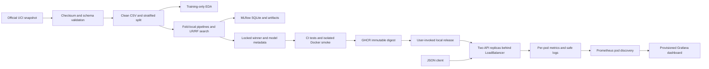

# Architecture

The report builder also renders [the diagram](../reports/figures/architecture.png)
as an original bitmap for the PDF. Tracking is not an inference dependency.
GitHub-hosted runners never receive a kubeconfig for the local machine. The release
manifest identifies the evaluated model and tested container; deployment does not
retrain. The local API has no authentication and is loopback-bound for demonstration.
The Kubernetes LoadBalancer is a local assignment endpoint, not a hardened public service.